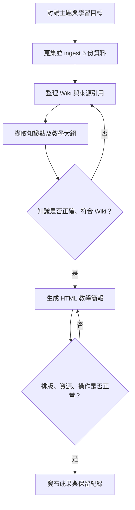

# LLM Wiki × HTML 教學簡報

**作業主題：Minecraft 3D 體素建模入門——以沙漠狐獴為例**

本專案利用 LLM Wiki 整理 Minecraft 的模型設計知識，再將知識轉換為可實際操作的 HTML 教學簡報。希望讓沒有接觸過 Blockbench 的人，也能從一隻「沙漠哨兵・狐獴」的建模過程，理解比例設計、骨骼、UV 貼圖及動畫的基本概念。

## 一、作業成果

| 項目 | 成果 |
| --- | --- |
| **LLM Wiki** | [Wiki 首頁與知識索引](./wiki/index.md) |
| **教學 HTML 簡報** | [簡報入口 index.html](./index.html)（可由 GitHub Pages 部署瀏覽） |
| **資料來源** | [5 篇來源與引用對照](./wiki/index.md#收錄的來源ingest)、[來源筆記](./sources/) |
| **實際執行紀錄** | [Wiki 更新紀錄](./wiki/log.md)、[自動檢查紀錄](./logs/) |
| **檢查工具** | [check_project.py](./tools/check_project.py) |

> 線上簡報如已啟用 GitHub Pages，可使用 https://niwi7yming4.github.io/llm-wiki-homework/ 瀏覽；若尚未啟用，請先至 Repository 的 Settings → Pages 部署。

## 二、LLM Wiki：資料如何建立？

這次採用「先討論、後生成」的方式：先確定初學者需要理解哪些知識，再蒐集與整理資料，最後建立五個 Wiki 章節，而不是直接請 AI 一次產生整份教材。

**共整理 5 份來源（ingest）：** Minecraft Wiki 的模型教學、Blockbench 官方文件、Microsoft Learn 動畫說明、動畫十二原則及 Pixel Art 相關介紹。每份來源的網址、日期及採用範圍都記錄於 [Wiki 索引](./wiki/index.md)。

| Wiki 章節 | 主要教學內容 |
| --- | --- |
| [01 空間尺度與體素解剖](./wiki/01_scale_and_voxel_anatomy.md) | Minecraft 尺度、模型比例、狐獴的體態 |
| [02 骨骼階層與 Pivot](./wiki/02_bone_hierarchy_and_pivots.md) | 骨骼父子關係、旋轉中心、避免關節斷裂 |
| [03 像素貼圖與色彩](./wiki/03_anti_dirty_texture_and_hue_shift.md) | 像素簇、限制色階、避免無意義雜訊 |
| [04 動畫與自然律動](./wiki/04_animation_physics_and_organic_timing.md) | 預備動作、緩入緩出、身體與尾巴的動態 |
| [05 建模訓練與變體](./wiki/05_academy_training_methodology.md) | 建模流程、技能練習、角色變體設計 |

Wiki 是簡報內容的依據；沙漠狐獴則是貫穿各章節的實作案例。外部資料與自行設定的模型參數也盡量分開標明，減少 AI 將設計選擇誤寫成通用規則的問題。

## 三、教學 HTML 簡報

將 Wiki 的內容轉換為 **10 頁互動式教學簡報**，從建模的基本觀念逐步帶到骨骼、貼圖與動畫，最後整理學習重點。

簡報採用 Minecraft 風格的操作介面，包含快捷列選頁、鍵盤翻頁、圖文示例與模型 GIF 動畫。比起大量堆疊技術名詞，這份教材希望讓讀者能夠「看到例子，再理解為什麼要這樣建模」。

## 四、Loop / Graph 設計

本次將流程分成「**知識內容檢查**」與「**HTML 教學成果檢查**」兩個循環：

- **Loop 1：內容檢查。** 檢查專有名詞、模型尺度及貼圖觀念是否與 Wiki 相符，並確認重要內容能找到來源。若內容有誤，回到 Wiki 或大綱階段修正。
- **Loop 2：簡報檢查。** 檢查 HTML 的頁數、連結、圖片、動圖及文字可讀性。若版面太擠或資源顯示不正常，只修改簡報，不必重做整個知識庫。

**這樣設計的原因**是把知識問題與前端呈現問題分開處理。先確定教材內容正確，再寫 HTML，可以避免完成介面後才因為概念錯誤而大幅返工。

## 五、實際執行與檢查紀錄

專案使用 [Python 檢查程式](./tools/check_project.py) 檢查來源數量、Wiki 引用、HTML 頁數、內部連結、動圖透明度及部分文字樣式。以下為 2026/11/23 保留的兩次紀錄：

| 檢查時間 | PASS | WARN | FAIL | 主要情況 |
| --- | ---: | ---: | ---: | --- |
| [第一次](./logs/check_20261123_235702.txt) | 21 | 2 | 10 | Wiki 缺索引、缺來源引用，部分數學標記未正確處理 |
| [修正後](./logs/check_20261123_235826.txt) | 29 | 2 | 2 | 已補齊 Wiki 索引與引用，仍有語法及 README 連結檢查項目未通過 |

這是當時的實際檢查快照，**不是全部測試都通過**。另外，簡報製作過程中也調整過動畫展示的頁面分配、字體大小及 GIF 背景，避免畫面資訊太密集或模型看不清楚。

## 六、反思與 Workflow 調整

**哪個節點最容易出錯？**  
主要集中在「資料整理成 Wiki」及「Wiki 轉換成簡報內容」的交界。第一次檢查時，Wiki 雖然已有五篇內容，卻缺乏清楚的來源引用；若直接拿去生成教材，容易把 AI 的敘述當成已查證的知識。

**把檢查提前到哪裡？**  
原先偏向完成 HTML 後再檢查，後來改成在 **Wiki 整理完成、產生 HTML 前**，先確認來源引用、專有名詞及教學大綱；前端完成後再檢查排版與操作。

**有修改 Graph 嗎？為什麼？**  
有。將原本「資料 → 簡報 → 檢查」的線性流程改成雙迴圈：**內容出錯就退回 Wiki，介面出錯就退回 HTML**。這樣能更容易定位問題，也不需要每次都重新生成整份成果。

---

本 Repository 保留 Wiki 內容、來源筆記、教學簡報、檢查紀錄與必要工程文件；README 則以本次作業的繳交項目為主。
